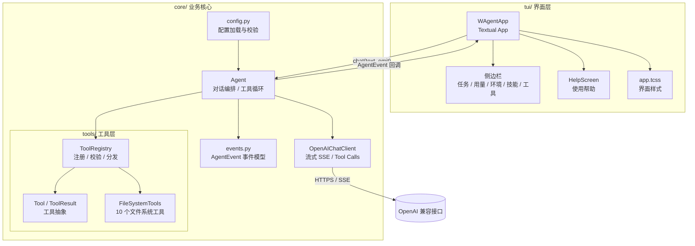

# wAgent

`wAgent` 是把 `Practice02/main-filetools.py` 改造后的本地文件智能体。项目按 **core（业务核心）+ tui（终端界面）** 分层，核心层不依赖 Textual，便于后续扩展 Web、Desktop 等其他界面。

## 架构



### 依赖方向

```text
tui  --->  core
core -/->  tui
```

- `core` 只处理配置、大模型调用、上下文、工具注册与执行，不导入 `textual`。
- `tui` 只负责输入、展示和事件消费，通过 `Agent.chat(text, emit)` 驱动核心。
- 新增界面时，复用 `Agent` 与 `AgentEvent` 即可，不需要修改业务逻辑。

## 目录结构

```text
Agent/wAgent/
├── main.py                  # 启动入口（自动处理包路径）
├── __main__.py              # 支持 python -m wAgent
├── requirements.txt
├── config.example.ini
├── .mcp.json               # MCP Server 连接配置（运行时读取当前工作目录）
├── core/
│   ├── agent.py             # Agent：多轮对话 + 工具调用循环 + 上下文压缩
│   ├── config.py            # 配置加载、校验、查找顺序
│   ├── context.py           # 上下文归档、Token 估算、压缩 Prompt
│   ├── sessions.py          # 会话事件日志、保存、列表与恢复
│   ├── events.py            # ContentDelta / ToolStarted 等事件
│   ├── llm.py               # OpenAI 兼容流式客户端
│   ├── skills.py            # Skill 发现、Frontmatter 解析与系统提示生成
│   ├── mcp.py               # MCP Client：.mcp.json 加载、连接、工具发现与调用
│   └── tools/
│       ├── base.py          # Tool、ToolResult 抽象
│       ├── cli.py           # runCli：执行本地命令行程序
│       ├── filesystem.py    # 文件系统工具实现
│       ├── web.py           # fetchWeb：curl + trafilatura 网页正文提取
│       ├── search.py        # searchWeb：百度千帆网络搜索
│       ├── context.py       # recallContext：检索历史归档
│       ├── skills.py        # loadSkill：按需加载 Skill 说明与附件
│       ├── registry.py      # 工具注册与 JSON 参数分发
│       └── __init__.py      # 默认工具集装配
└── tui/
    ├── app.py               # Textual 应用、侧边栏与事件渲染
    ├── compact.py           # 压缩前后上下文对照面板
    ├── sessions.py          # 历史会话列表面板
    ├── setup.py             # 首次运行配置提示对话框
    ├── help.py              # F1 / /help 使用帮助弹窗
    ├── app.tcss             # 界面样式
    └── __init__.py
```

## 快速开始

```bash
cd D:\zuoye\Agent\wAgent
pip install -r requirements.txt
python main.py
```

也可以从 `Agent` 目录运行：

```bash
python -m wAgent
```

指定配置文件：

```bash
python main.py --config D:\path\to\config.ini
```

## 配置

复制模板并填写真实密钥：

```bash
copy config.example.ini config.ini
```

```ini
[openai]
base_url = https://api.deepseek.com/v1
api_key = your-api-key
model = deepseek-chat

[agent]
max_tool_rounds = 10
request_timeout = 60
# 可选：模型上下文窗口；不填时按 128k 显示并标注「默认」
# context_window = 128k
# 可选：压缩摘要请求的最大输出 tokens
# compact_max_tokens = 8192
# 可选：上下文警告比例、压缩摘要目标 tokens、AGENTS.md 文件名
# context_warning_ratio = 0.6
# compact_summary_tokens = 5000
# agents_md_file = AGENTS.md

[session]
directory = .agents/sessions
auto_save_on_quit = true

[ui]
refresh_interval = 0.5
sidebar_breakpoint = 100

[tools]
cli_timeout = 30
web_timeout = 20
mcp_connect_timeout = 30
mcp_call_timeout = 60
```

当前目录没有 `config.ini` 时，程序会自动创建一份包含 mock 占位值的完整配置，并弹出提示对话框；修改 `base_url`、`api_key`、`model` 后重新启动。

配置查找顺序：

1. `--config` 指定路径
2. 环境变量 `WAGENT_CONFIG`
3. 当前工作目录下的 `config.ini`
4. `wAgent/config.ini`
5. `wAgent/congfig.ini`（兼容指定文件名）
6. `Agent/Practice02/config.ini`（兼容旧配置）

搜索配置示例：

```ini
[search]
baidu_qianfan_api_key = your-baidu-qianfan-api-key
top_k = 8
timeout = 20
```

`baidu_qianfan_api_key` 也兼容 `baidu qianfan api key`、`baidu_api_key` 和 `api_key` 等写法。

## MCP Client

wAgent 会读取当前工作目录（也就是运行 wAgent 的项目目录）下的 `.mcp.json`。TUI 先完成启动，再在后台线程异步连接 MCP Server 并调用 `list_tools()` 自动发现工具；连接完成后右侧边栏的 MCP 区域和工具列表会自动刷新。也可以通过环境变量 `WAGENT_MCP_CONFIG` 指定其他配置文件路径。

```json
{
  "mcpServers": {
    "Bazi-MCP": {
      "type": "streamable_http",
      "url": "https://mcp.api-inference.modelscope.net/ac7cf4c8419648/mcp"
    },
    "local-demo": {
      "type": "stdio",
      "command": "python",
      "args": ["server.py"],
      "env": {
        "API_TOKEN": "${API_TOKEN}"
      }
    }
  }
}
```

- 支持 `stdio` 和 `streamable_http` 两种标准传输，同时兼容 `sse`。
- 发现的工具会注册到现有 `ToolRegistry`，与 `runCli`、`fetchWeb`、`loadSkill` 等本地工具统一参与 Function Calling。
- 不同 MCP Server 出现同名工具，或与本地工具重名时，会为 LLM 暴露 `<服务器名>__<工具名>` 形式的前缀名称；内部维护暴露名称到“服务器 + 原始工具名”的映射。
- MCP 工具的描述以 `[MCP:服务器名]` 开头，便于模型识别来源。
- 某个 MCP Server 连接失败时，只在标准错误输出明确提示，不影响其他 MCP Server 和本地工具。

## TUI 操作

| 操作 | 说明 |
|------|------|
| `Enter` | 发送问题 |
| `Shift+Enter` / `Ctrl+J` | 在输入框中手动换行（也可直接输入长文本，输入框会自动换行并自动增高） |
| 输入 `/` | 在输入框上方弹出命令列表 |
| `Up` / `Down` | 在命令列表中选择 |
| `Tab` | 补全当前选中的命令 |
| `Enter`（命令列表打开时） | 执行当前选中的命令 |
| `Esc` | 关闭命令列表 |
| `/help`、`F1` | 打开使用帮助 |
| `/new`、`Ctrl+N` | 新建会话，并自动保存当前会话 |
| `/resume`、`/sessions` | 打开历史会话面板，`Up/Down` 选择、`Enter` 恢复、`Esc` 取消 |
| `/save` | 保存当前会话到 `.agents/sessions/` |
| `/status` | 查看会话、上下文和 MCP 状态 |
| `/mcp` | 查看 MCP 服务器及其工具 |
| `/tools` | 在对话区查看全部已注册工具及简短说明 |
| `/skills` | 在对话区查看已发现的 Agent Skills |
| `/compact` | 归档原始上下文并生成压缩摘要 |
| `/clear` | 清空对话上下文和界面记录 |
| `/quit`、`/exit` | 保存当前会话并退出 |
| `Ctrl+B` | 显示或隐藏侧边栏 |
| `Ctrl+L` | 清空上下文 |
| `Ctrl+Q` | 保存并退出 |

界面会实时展示：

- 模型流式输出的正文
- 每次工具调用的名称与参数
- 工具执行结果（失败时标红）
- 配置错误、接口错误等异常信息

用户消息与助手回复统一使用 6 列标签缩进，多行内容和自动换行后的续行会对齐到正文列。助手回复会识别常见 Markdown 结构：标题、列表、引用、分隔线、表格、行内代码与代码块，并以更清晰的样式渲染。

### 页面结构

- **顶部栏**：左侧显示 wAgent 标识，右侧显示当前模型和工作目录。
- **欢迎页**：首次启动时主区域居中展示带轻微右下投影的像素风 WAGENT 标识，以及副标题、模型/目录/工具信息卡片和快捷提示；发送消息后切换为对话区，清空上下文后重新显示。
- **对话区**：占据主区域，不使用厚重边框，让消息和代码块获得更多横向空间。
- **底部输入区**：状态行、命令列表、多行输入框和快捷键提示集中排列，输入框获得焦点时高亮边框。
- **右侧边栏**：展示任务、用量、环境、MCP 服务器、技能和工具；MCP 区域在界面启动后异步加载并动态刷新，显示已连接服务器及每个服务器的工具。终端宽度小于配置阈值（默认 100 列）时隐藏，可用 `Ctrl+B` 打开。

### 会话管理与 AGENTS.md

- **会话日志**：当前会话以 JSONL 事件日志保存在 `.agents/sessions/`，记录会话头、消息追加、标题、快照和保存检查点。
- **自动保存**：`/new` 会先保存当前会话再创建新会话；`/quit` 默认自动保存；每轮对话结束后也会同步写入新消息。
- **恢复会话**：`/resume` 打开历史会话面板，展示编号、标题、更新时间和消息数，选中后用历史消息替换当前上下文。
- **AGENTS.md**：会话首次加载时若当前目录存在 `AGENTS.md`，会作为一条带标记的消息追加到聊天历史，并随会话日志持久化；后续轮次直接复用，不会重复注入。
- **首次配置**：当前目录缺少 `config.ini` 时，程序会自动生成一份完整 mock 配置并弹出提示对话框；修改 `base_url`、`api_key`、`model` 后重新启动。

### 上下文压缩与历史检索

- **用量监控**：顶部栏醒目显示「当前上下文 k / 模型窗口 k / 占用百分比」。模型窗口可通过 `[agent] context_window` 配置；未配置时按 128k 计算并标注「默认」。
- **60% 警告**：每次模型响应后检查上下文用量，达到模型窗口的 60% 时写入警告并暂停接受普通提示词，直到执行 `/compact`。
- **原始归档**：压缩前先把完整消息（角色、内容、工具调用参数、工具结果、顺序）写入当前目录 `.agents/context/<编号>.jsonl`；归档失败则终止压缩。
- **摘要生成**：归档成功后调用专门的压缩 Prompt，请求模型输出约 5,000 Tokens 的 Markdown 工作摘要。
- **结果替换**：摘要成功后保留 System Prompt 与工具定义，用摘要替换历史消息，并在末尾追加归档编号说明；同时弹出左右两栏的压缩前后对照面板。
- **历史检索**：`recallContext` 工具支持按 `text` 关键词检索全部归档，或用 `id` 限定归档编号，返回匹配片段、归档编号和消息位置。

### 视觉风格

- 整体采用深色背景搭配暖橙/杏色强调色，欢迎页、顶部栏、输入区、侧边栏和帮助页保持统一色调。
- 正文、用户消息、助手消息和工具结果默认使用浅色字体；标题、加粗重点、行内代码、链接、列表标记和工具名使用暖橙强调色，错误信息使用红色。
- 用户与助手标签使用强调色粗体，并通过 `›`、`◆` 标记区分角色。
- 代码块正文保持白色，避免整块高亮影响阅读。
- 顶部栏、输入区和命令列表使用细边框与低对比背景，减少视觉噪音。

### 侧边栏

右侧边栏展示运行状态：

- **任务进度**：当前状态、轮次进度条、本回合工具调用次数、当前工具、耗时、上下文消息数
- **模型使用**：接口请求次数、输入/输出/合计 token 用量（按会话累计）
- **运行环境**：模型、工作目录、接口地址、配置文件路径、超时、最大轮次
- **可用技能**：从当前目录 `.agents/skills/` 动态发现的所有 Skill 名称与简要说明
- **可用工具**：从工具注册表动态读取的全部工具名称，并为每个工具附带一句话作用说明

token 用量来自接口返回的 `usage` 字段。如果服务端不返回该字段，用量会显示为 0。

### 使用帮助

按 `F1` 或在输入框执行 `/help`，会打开帮助页，包含：

- 快速上手步骤
- 命令与快捷键
- 可执行任务与常用示例
- 文件类型、编码、大小限制
- 侧边栏字段说明
- 配置文件查找顺序

## 内置工具

| 工具 | 功能 |
|------|------|
| `getCurrentDirectory` | 获取当前工作目录 |
| `listDirectory` | 列出目录下的文件和子目录 |
| `getFileType` | 获取扩展名、MIME、文本/二进制类型 |
| `readTextFile` | 读取纯文本文件内容 |
| `createFile` | 创建文件，可自动创建多级目录 |
| `editFile` | 覆盖、追加、局部替换文本 |
| `createDirectory` | 创建目录 |
| `deleteDirectory` | 递归删除非空目录 |
| `deleteFile` | 删除文件 |
| `renamePath` | 重命名或移动文件/目录 |
| `fetchWeb` | 通过本地 curl 获取网页 HTML，再用 trafilatura 提取正文并转为 Markdown |
| `searchWeb` | 调用百度千帆网络搜索 API，返回搜索摘要、来源标题和 URL |
| `runCli` | 执行本地已安装的命令行程序，返回标准输出、标准错误和退出码 |
| `loadSkill` | 按需加载 `.agents/skills` 中的 Skill 说明或附件文件 |
| `createSkill` | 根据自然语言要求在 `.agents/skills/` 下创建新的 Skill 与 `SKILL.md` |

文件工具的限制与保护：

- 仅支持纯文本，当前识别 UTF-8（含 BOM）与 GBK 编码，UTF-16 文件会被视为二进制。
- 读取文件上限为 1 MB。
- 删除和重命名会拒绝磁盘根目录。
- 工具异常统一转换为 `ToolResult(ok=False)`，不会中断对话循环。

网页工具的限制与保护：

- 仅允许 `http://` 和 `https://` URL，并限制重定向协议，避免访问本地文件协议。
- 通过 `subprocess` 以参数列表调用 curl，不使用 `shell=True`；默认超时 20 秒。
- 限制下载大小和 Markdown 正文长度，避免异常页面消耗过多上下文。
- 使用 trafilatura 去除导航、广告、页脚等无关内容，保留标题、段落、列表、表格和链接。
- 网页访问失败、超时、HTTP 错误、HTML 解析失败或正文无法提取时，会返回中文错误信息。
- 需要本地已安装 curl；Windows 10/11 通常自带 `curl.exe`，也可用 `WAGENT_CURL` 指定路径。

网络搜索工具 `searchWeb`：

- 使用百度千帆「百度搜索」API：`POST https://qianfan.baidubce.com/v2/ai_search/web_search`。
- 通过配置文件 `[search]` 小节的 `baidu_qianfan_api_key` 读取 API Key，不在代码中硬编码。
- 返回搜索结果摘要、来源标题、URL、站点和发布时间，自动去重并限制摘要长度。
- 缺少 API Key、网络失败、请求超时、HTTP 错误、API 业务错误或返回 JSON 异常时，会以中文错误信息返回给模型。
- 单次查询会按接口限制截取到 72 个字符宽度以内。

本地命令行工具 `runCli`：

- 接收程序名称 `command` 和参数列表 `args`，例如 `command="git"`、`args=["--version"]`。
- 通过 `shutil.which` 在 `PATH` 中查找程序，再以参数列表形式调用 `subprocess.run`，固定使用 `shell=False`，避免 Shell 字符串拼接与转义问题。
- 返回标准输出、标准错误和退出码；非零退出码不会被当成工具异常，交由模型判断执行结果。
- 默认超时 30 秒；超时后会终止进程并返回已捕获的部分输出，同时标注超时状态。
- 标准输出和标准错误分别截断到 8000 个字符，并明确标注截断位置和省略字符数。
- 自动识别 UTF-8、系统默认编码和 GBK，兼容 Windows 命令行程序的中文输出。
- 仅用于受控教学实验环境：当前按运行 wAgent 的用户权限执行，未实现命令白名单、黑名单和审批机制，请勿在不可信环境中使用。

## Agent Skills

wAgent 支持按需加载 Agent Skills。程序启动时会把当前工作目录作为项目根目录，扫描 `.agents/skills/` 下的各个 Skill 子目录：

```text
.agents/skills/
└── pdf-processing/
    ├── SKILL.md
    └── references/
        └── forms.md
```

`SKILL.md` 开头使用 YAML Frontmatter 声明必需字段：

```markdown
---
name: pdf-processing
description: 提取 PDF 文本、填写表单并合并文档。
---

# PDF Processing

详细步骤只在模型调用 `loadSkill` 时才进入上下文。
```

初始化阶段只读取 `name` 和 `description`，并把它们加入 System Prompt。模型需要完整说明时调用：

- `loadSkill(name="pdf-processing")`：返回 `SKILL.md` 全文。
- `loadSkill(name="pdf-processing", filename="references/forms.md")`：只返回指定附件，不重复加载 `SKILL.md`。

`filename` 支持相对 Skill 目录、相对项目根目录和绝对路径；只给文件名时会递归搜索该 Skill 目录。匹配结果唯一时直接读取，存在多个同名文件时返回候选路径。所有读取都会被限制在对应 Skill 目录内部。

模型也可以根据用户的自然语言要求调用 `createSkill` 创建新 Skill：

- `name`：Skill 名称，会自动规范为小写字母、数字和连字符组成的格式，并用作子目录名。
- `skillContext`：要写入 `SKILL.md` 的完整内容，可自带 YAML Frontmatter；未提供时会自动补充 `name` 与 `description`。

目标目录或同名 Skill 已存在时不会覆盖，而是返回明确提示。创建后 Skill 会立即加入当前会话的 Skill 目录。若还需要创建 `references/`、`scripts/` 等目录或辅助文件，模型会继续调用 `createFile`、`createDirectory` 等文件工具完成。

## 核心事件流

```python
agent.chat("读取 D:/demo/a.txt", emit=on_event)
```

核心会依次产生：

```text
RoundStarted(number, max) # 新一轮模型调用
ContentDelta(text)        # 模型正文增量
UsageUpdated(tokens)      # 请求次数与 token 用量
AssistantCompleted(text)  # 一轮正文结束
ToolStarted(name, args)   # 开始执行工具
ToolFinished(name, ok)    # 工具执行结果
AgentError(message)       # 请求或配置异常
```

TUI 在后台线程中调用 `agent.chat`，通过 `call_from_thread` 把事件送回 UI 线程渲染。

## 扩展新界面

新增 Web 或 Desktop 界面时，只需要：

1. 在 `wAgent/` 下新建 `web/` 或 `desktop/` 目录。
2. 复用 `Agent` 的构造方式和 `chat(text, emit)` 接口。
3. 将 `AgentEvent` 映射到目标界面的消息模型。

例如：

```python
from wAgent.core.agent import Agent
from wAgent.core.config import load_config

agent = Agent(load_config())

def on_event(event):
    # 推送到 WebSocket、Qt 信号或 HTTP SSE
    ...

agent.chat("列出当前目录", emit=on_event)
```

不要在新的界面层里直接调用 `FileSystemTools` 或拼接大模型请求；工具调用和上下文管理应始终留在 `core`。
